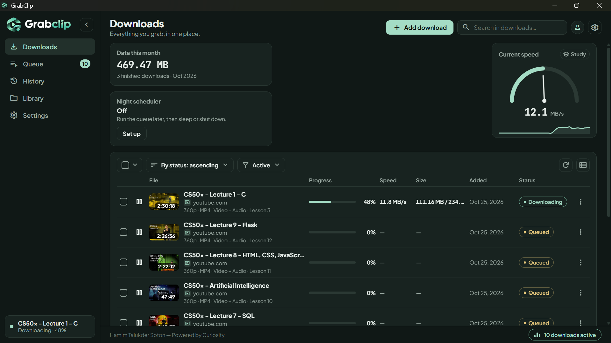
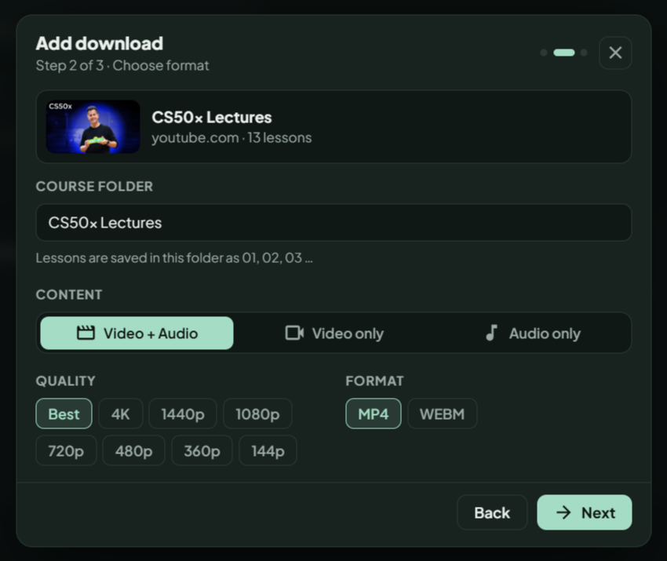
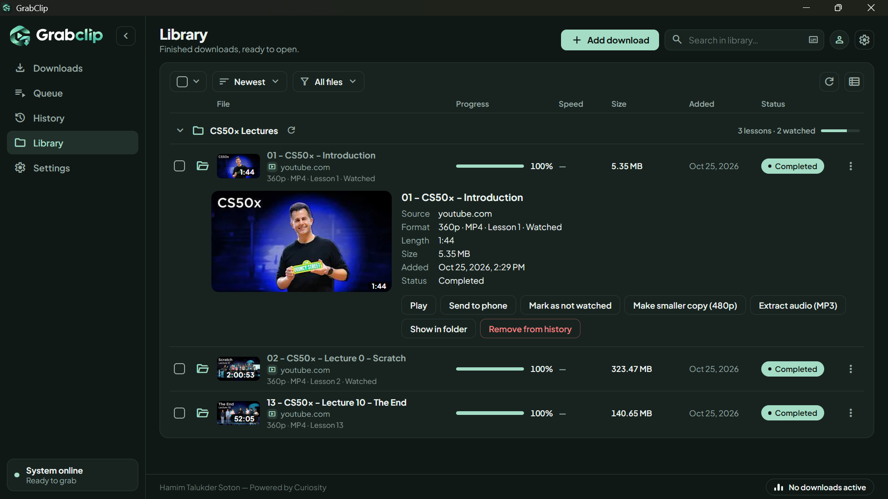
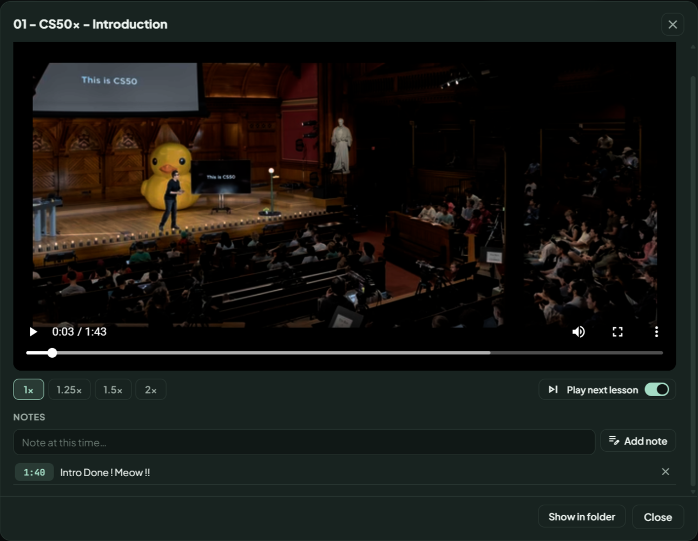
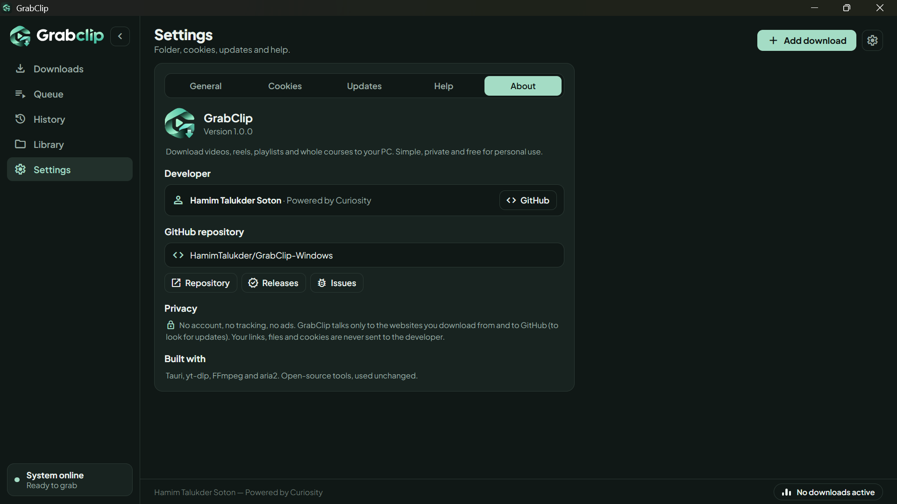

<p align="center">
  <a href="https://github.com/HamimTalukder/GrabClip-Windows/releases/latest">
    
  </a>
</p>

<h1 align="center">GrabClip</h1>

<p align="center">
  <b>Download videos, reels, playlists and whole courses to your PC.<br>A simple, offline-friendly Windows desktop app.</b>
</p>

<p align="center">
  Paste a link, pick a quality, press Download. No terminal, no Python, no setup:
  the download engine is built in. Then watch your files in the built-in Library and player,
  search inside videos, or send them to your phone with a QR code.
</p>

<p align="center">
  
  
  
  
  
</p>

<p align="center">
  <a href="https://github.com/HamimTalukder/GrabClip-Windows/releases/latest"></a>
</p>

<p align="center">
  <a href="#features">Features</a> ·
  <a href="#install">Install</a> ·
  <a href="#quick-start">Quick start</a> ·
  <a href="#private-and-login-only-videos-cookies">Cookies</a> ·
  <a href="#troubleshooting">Troubleshooting</a> ·
  <a href="#faq">FAQ</a> ·
  <a href="#license-and-credits">License</a>
</p>

<p align="center">
  
</p>

## Features

**Download**
- **Analyze first:** thumbnail, title, site, duration and estimated size before you download.
- **Sources:** YouTube, Facebook, Instagram, TikTok and many other sites.
- **Video + Audio, Video only, Audio only.**
- **Quality:** Best, 4K, 1440p, 1080p, 720p, 480p, 360p, 144p.
- **Audio:** Best, MP3, AAC, OPUS, FLAC.
- **Video format:** WEBM (original file, no conversion) or MP4.
- **Extras:** embedded subtitles (English + Bangla), embedded thumbnail and metadata.
- **Fast download:** multi-connection mode for higher speed.
- **Download only a part:** grab a time range, for example 12:30 to 15:10.
- **Download as a course:** a playlist link becomes a course folder with numbered lessons.
- **Many links at once:** paste up to 50 links, or drag a link onto the window.

<table>
  <tr>
    <td width="50%"><br><sub>Add download: format, quality and estimated size</sub></td>
    <td width="50%"><br><sub>Library: course folders, watched marks and progress</sub></td>
  </tr>
  <tr>
    <td width="50%"><br><sub>Built-in player with resume, speed and notes</sub></td>
    <td width="50%"><br><sub>Settings: folder, cookies, notifications, engine</sub></td>
  </tr>
</table>

**Queue and control**
- **One-by-one queue** that starts the next download by itself.
- **Pause, resume, cancel.** Partial files are kept, so a download continues where it stopped.
- **Saved queue:** waiting downloads come back after you restart the app.
- **Night scheduler:** start the queue at a set time, limit speed, then do nothing, sleep or shut down.
- **Study mode:** cap the speed (500 KB/s, 1 MB/s, 2 MB/s) so your internet stays usable.
- **Automatic network retry** when the connection drops.
- **Disk space guard:** pauses before a download fails halfway.
- **Link suggestion** from your clipboard, **duplicate warning**, and a **monthly data counter**.

**Library and player**
- **Downloads, Queue, History and Library** pages with search, sort, filters and bulk actions.
- **Courses:** lessons grouped in folders with watched marks; **Check for new lessons** adds only what is new.
- **Built-in player:** resumes where you stopped, speed 1x to 2x, time-stamped notes, play next lesson.
- **Search inside videos:** find spoken words in videos that have subtitles and jump to that second.
- **Send to phone:** scan a QR code over the same Wi-Fi.
- **Make smaller copy (480p)** and **Extract audio (MP3)** from finished videos.

**App**
- Windows notifications and a tray icon, so downloads keep running when you close the window.
- **Update yt-dlp** button: fixes most "this site stopped working" problems without a new app version.
- **Check for updates** button for new GrabClip versions.
- Cookies import with a health check per site.
- Calm dark interface, works fully offline (fonts and icons are bundled).

## Install

**Requirements:** Windows 10 or 11, 64-bit. Nothing else to install.

| Build | File | Notes |
|---|---|---|
| Windows x64 | `GrabClip_<version>_x64-setup.exe` | Installs for your user only, no admin permission needed |

1. Open the [latest release](https://github.com/HamimTalukder/GrabClip-Windows/releases/latest).
2. Download the `.exe` under **Assets**.
3. Run it and finish the installer, then open **GrabClip** from the Start menu.

**Windows shows a blue "Windows protected your PC" screen?** The installer is not code-signed yet (signing costs money), so SmartScreen warns about every new app. Click **More info → Run anyway**. To verify your download, compare its SHA-256 with the one shown next to the file on the release page:

```powershell
Get-FileHash .\GrabClip_1.0.0_x64-setup.exe -Algorithm SHA256
```

Some antivirus programs flag the installer because yt-dlp and ffmpeg are inside. This is a false positive.

**Update:** run the new installer over the old one (settings, history and library are kept), or use **Settings → Check for updates**. All versions and their notes are on the [Releases page](https://github.com/HamimTalukder/GrabClip-Windows/releases) and in the [changelog](CHANGELOG.md).

**Uninstall:** Settings → Apps → GrabClip. Your downloaded videos are never touched.

## Quick start

1. Click **Add download** and choose the source tab.
2. Paste the link and press **Analyze link** (or Enter).
3. Choose content, quality and format, then **Next**.
4. Pick extras (subtitles, thumbnail, fast, part only), then **Download**.

The download appears in the list with live progress. Finished files go to **Library**.

## Private and login-only videos (cookies)

Facebook, Instagram and some YouTube videos need you to be logged in. GrabClip uses a `cookies.txt` file from your own browser:

1. Install **Get cookies.txt LOCALLY** for [Chrome / Edge / Brave](https://chromewebstore.google.com/detail/get-cookiestxt-locally/cclelndahbckbenkjhflpdbgdldlbecc) or [Firefox](https://addons.mozilla.org/en-US/firefox/addon/get-cookies-txt-locally/).
2. Log into the site in your browser, open the extension and **Export**.
3. In GrabClip open **Settings → Cookies → Import** and pick the file.

Cookies stay on your PC and are never uploaded. **Remove** deletes them any time.

> [!WARNING]
> `cookies.txt` is your logged-in session. **Never share it**, and never post it in an issue or a screenshot.

## Troubleshooting

| Problem | Fix |
|---|---|
| A site stopped working | **Settings → Download engine → Update yt-dlp** |
| "Sign in" or bot-check error | Export fresh cookies and import them again (**Update cookies**) |
| File cannot be saved | Use a normal folder, not inside OneDrive and not a "Controlled folder access" location |
| MP4 does not play in an old player | Some sites use VP9 / AV1 video. Try VLC or the built-in player |
| Send to phone does not open | Phone and PC must be on the same Wi-Fi. Allow GrabClip in the Windows Firewall prompt |
| Built-in player shows nothing | It plays MP4 (H.264), WebM and similar. Use **Show in folder** for other files |
| Low speed | Turn on **Fast download** in step 3 of Add download |

**Where your data lives:** `%APPDATA%\GrabClip` (settings, history, saved queue, cookies). Still stuck? [Open an issue](https://github.com/HamimTalukder/GrabClip-Windows/issues/new/choose) and describe what happened. Do not attach your cookies.

## FAQ

**Is it free?** Yes, free for personal use. See the [license](LICENSE.txt).

**Does it upload my links or files?** No. There are no accounts and no tracking. The app only talks to the sites you download from, and to GitHub when you check for updates.

**Mac or Linux?** Windows only for now.

**Can it download DRM-protected videos or torrents?** No.

**Why are ffmpeg and aria2 in the install folder?** They are the open-source tools GrabClip uses for merging, converting and fast downloads. See [third-party notices](THIRD_PARTY_NOTICES.md).

## Roadmap

New versions and fixes are published on the [Releases page](https://github.com/HamimTalukder/GrabClip-Windows/releases) and described in the [changelog](CHANGELOG.md). Ideas and bugs are welcome in [Issues](https://github.com/HamimTalukder/GrabClip-Windows/issues). Postponed for now: a browser button that sends a link straight to the app.

## Responsible use

GrabClip is a personal-use tool for content you have the right to save, such as your own paid class recordings. It does not host or share any video. Please respect copyright and the terms of the sites you use.

## License and credits

GrabClip is **free for personal use**; see [LICENSE.txt](LICENSE.txt). The source code is not public. The bundled open-source tools keep their own licenses, listed in [THIRD_PARTY_NOTICES.md](THIRD_PARTY_NOTICES.md).

Built with [Tauri](https://tauri.app/) and powered by [yt-dlp](https://github.com/yt-dlp/yt-dlp), [FFmpeg](https://ffmpeg.org/) and [aria2](https://aria2.github.io/).

## Author

Built by **Hamim Talukder Soton**.

[Facebook](https://www.facebook.com/hamim.talukder.soton) · [LinkedIn](https://www.linkedin.com/in/hamim-talukder) · [GrabClip web command generator](https://hamimtalukder.github.io/GrabClip/)

<p align="center">
  <sub>Made with curiosity by <a href="https://github.com/HamimTalukder">Hamim Talukder Soton</a>.</sub>
</p>
